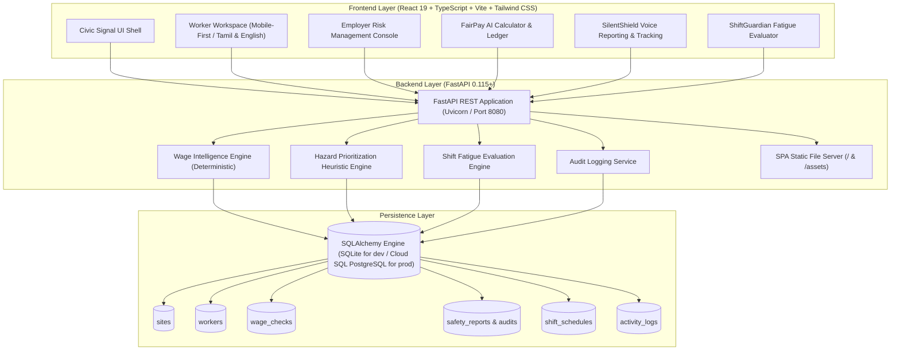

# FairShift — Human-Centered Workforce Intelligence

> **“Every hour counts. Every voice matters.”**  
> Aligned with **UN Sustainable Development Goal 8: Decent Work and Economic Growth**  
> *PromptWars 2026 × SRM ACM Student Chapter Hackathon Submission*

---

## 1. Product Vision & Executive Summary

**FairShift** is a worker-first fairness and workplace safety platform designed for frontline workers and institutional operations teams. In high-tempo operational environments, frontline personnel often experience unrecorded overtime, hazardous conditions that go unreported due to fear or friction, and fatigue from back-to-back shift assignments.

FairShift bridges this gap with an explainable, deterministic intelligence engine across two distinct high-stakes contexts:

1. **Construction Sites** — Daily wage scaffolders, rebar specialists, and electricians dealing with overtime pay reconciliation, exposed high-voltage wiring, missing fall-protection PPE, and fatigue from physical labor.
2. **College Facilities** — Campus custodial personnel, security guards, and maintenance technicians coping with split shifts, broken cleaning equipment, electrical/chiller leaks in basements, and double-shift burnout.

---

## 2. Three Integrated Modules

### A. FairPay AI — Transparent Wage Intelligence
- **Deterministic Math**: Calculates regular pay and statutory overtime pay using configurable demonstration benchmarks (e.g., Factories Act 1948 Section 59 double rate / 2.0x overtime multiplier).
- **Rupee (₹) Formatting**: Native currency display with clear numerical breakdown.
- **Formula Transparency**: Explains each step with explicit formulas and contextual explanations rather than unverified black-box scores.
- **Categorization**: Classifies every check as `LOOKS_CONSISTENT`, `NEEDS_REVIEW`, or `POTENTIAL_DISCREPANCY`.

### B. SilentShield — Worker Voice & Safety Reporting
- **Multi-Modal Input**: Text input paired with browser-native Web Speech recognition supporting both English (`en-IN`) and தமிழ் Tamil (`ta-IN`).
- **Compound Hazard Heuristics**: Deterministic rule engine detects high-consequence compounds (e.g., *Electrical + Water Presence = CRITICAL*).
- **Verified Reference Codes**: Generates immutable reference IDs (`FS-2026-XXXXX`) allowing workers to track investigation progress without exposing their personal identities.
- **Supervisor Workflow**: Authorized employer users can transition reports (`OPEN` → `ACKNOWLEDGED` → `UNDER_INVESTIGATION` → `RESOLVED` / `ESCALATED`) with an audit trail.
- **Confidential Mode**: Built-in privacy shield that never leaks worker details or forwards sensitive reports to external AI providers.

### C. ShiftGuardian — Fatigue & Schedule Risk
- **Fatigue Science Rules**: Evaluates shift length, inter-shift rest recovery windows, and consecutive workday streaks.
- **Critical Thresholds**:
  - *Long Shift*: Net duty > 12 hours (`CRITICAL`)
  - *Rest Deficit*: Recovery interval < 8 hours (`CRITICAL`) or < 11 hours (`HIGH`)
  - *Consecutive Duty*: 7+ consecutive days without statutory rest day (`HIGH`) or 12+ days (`CRITICAL`)
- **Directives for Supervisors**: Issues actionable mitigation steps (e.g., mandate 12h recovery window, dispatch standby worker).

---

## 3. System Architecture



---

## 4. Visual Identity — "Civic Signal"

The product implements the **Civic Signal** design system:
- **Midnight Canvas**: `#101827` (Deep backdrop offering maximum optical contrast)
- **Deep Surfaces**: `#172235` (Glassmorphic cards with subtle white borders)
- **Electric Teal**: `#42E6C4` (Primary accent for fairness, verification, and healthy telemetry)
- **Signal Amber**: `#FFBF69` (Warnings, rest deficit indicators, and reviews)
- **Alert Coral**: `#FF6B6B` (Urgent hazards, electrocution risks, and pay shortfalls)
- **Warm Ivory**: `#F6F3EA` (Editorial typography optimized for readability)

---

## 5. Local Setup & Running (Windows-Friendly)

### Prerequisites
- Python 3.12+ (or installed via `uv`)
- Node.js v20+ and npm
- (Optional) `uv` for lightning-fast Python package resolution

### Step 1: Clone & Navigate
```powershell
git clone <repository_url>
cd <repository_folder>
```

### Step 2: Set Up Python Backend
```powershell
# Using uv (Recommended):
uv venv --python 3.12 .venv
uv pip install --python .venv\Scripts\python.exe -r requirements.txt

# Or using standard venv:
python -m venv .venv
.\.venv\Scripts\activate
pip install -r requirements.txt
```

### Step 3: Set Up Frontend & Build Production Assets
```powershell
cd frontend
npm install
npm run build
cd ..
```

### Step 4: Run the Application
You can run the full unified production stack with a single command:
```powershell
.\.venv\Scripts\python.exe -m uvicorn backend.main:app --host 0.0.0.0 --port 8080
```
Open **[http://localhost:8080](http://localhost:8080)** in your browser!

To run in separate development mode with Hot Module Replacement (HMR):
```powershell
# Terminal 1 (Backend API):
.\.venv\Scripts\python.exe -m uvicorn backend.main:app --host 127.0.0.1 --port 8080 --reload

# Terminal 2 (Frontend Dev Server):
cd frontend
npm run dev
# Visit http://localhost:5173
```

---

## 6. Running Tests

### Backend Unit & Integration Tests (18 test cases)
```powershell
.\.venv\Scripts\pytest -v
```
**Coverage**:
- Daily rate and hourly wage calculations with overtime multipliers
- Compound hazard detection (Electrical + Water = CRITICAL)
- Tamil and English safety keyword prioritization
- Extreme shift length, recovery rest deficits, and consecutive workday breaches
- API endpoints: Health check, Dashboard metrics with industry filters, SilentShield status transitions, FairPay calculation.

### Frontend Flow Tests (Vitest)
```powershell
cd frontend
npm run test
```

---

## 7. Mandatory Google Cloud Run Deployment Guide

FairShift is built as a single container serving both the React SPA and the FastAPI REST API, completely eliminating cross-origin complications and duplicate container costs.

### Prerequisites for Deployment
- Google Cloud Project with Cloud Run and Artifact Registry enabled
- `gcloud` CLI installed and authenticated (`gcloud auth login`)
- (Recommended) Cloud SQL for PostgreSQL instance

### Step-by-Step Deployment Commands

```bash
# 1. Set Google Cloud Project & Region
export PROJECT_ID="your-gcp-project-id"
export REGION="asia-south1" # or us-central1
gcloud config set project $PROJECT_ID

# 2. Build and Submit Container Image to Google Artifact Registry / Cloud Build
gcloud builds submit --tag gcr.io/$PROJECT_ID/fairshift:latest .

# 3. Deploy to Google Cloud Run
gcloud run deploy fairshift \
  --image gcr.io/$PROJECT_ID/fairshift:latest \
  --platform managed \
  --region $REGION \
  --allow-unauthenticated \
  --port 8080 \
  --set-env-vars APP_ENV=production,DATABASE_URL=sqlite:///./fairshift.db \
  --memory 512Mi \
  --cpu 1

# 4. (For Persistent Cloud SQL PostgreSQL Production Deployment):
# Create Cloud SQL database instance:
# gcloud sql instances create fairshift-db --database-version=POSTGRES_15 --tier=db-f1-micro --region=$REGION
# Add Cloud SQL connection to Cloud Run:
# gcloud run services update fairshift \
#   --add-cloudsql-instances $PROJECT_ID:$REGION:fairshift-db \
#   --set-env-vars DATABASE_URL=postgresql+psycopg2://<user>:<password>@/<dbname>?host=/cloudsql/$PROJECT_ID:$REGION:fairshift-db
```

### Health Check Verification
Once deployed, verify Cloud Run health:
```bash
curl -f https://<YOUR-CLOUD-RUN-URL>/api/system/health
```

---

## 8. Three-Minute Judge Demonstration Script

| Time | Module | Demonstration Action | What the Judge Sees |
|---|---|---|---|
| **0:00 - 0:45** | **Hero & Vision** | Open landing page; explain UN SDG 8 alignment and dual industrial scope (Construction & College Facilities). | Civic Signal UI, high-contrast dark palette, live product preview. |
| **0:45 - 1:30** | **FairPay AI** | Click *Explore Demo* → Switch to **Construction** → Open **FairPay AI** → Load preset *"Raman K."* → Click *Check My Pay*. | **₹1,625 Shortfall** flagged with step-by-step formula showing 14 overtime hours compensated below statutory 2.0x double rate. |
| **1:30 - 2:15** | **SilentShield** | Open **SilentShield** → Load preset *"Water on Breaker"* or speak in Tamil *"மின்சார பெட்டி அருகில் தண்ணீர்"* → Click *Submit Report*. | Explainable compound hazard heuristic triggers **CRITICAL priority**; generates reference code `FS-2026-XXXXX`. |
| **2:15 - 2:45** | **Employer Console** | Switch demo role to **Employer** → View triage queue → Click **Acknowledge** & **Start Investigation** on the report → Open **Track Report** to show live supervisor audit trail. | Real-time status update with supervisor audit log without page refresh. |
| **2:45 - 3:00** | **ShiftGuardian** | Open **ShiftGuardian** → Load *"Murugan S."* (13.5h duty + 7h rest breach) → Click *Evaluate Shift Risk*. | **CRITICAL Risk Rating** with fatigue rules explaining acute sleep deficit and motor reflex drop. |

---

## 9. Security, Privacy & Limitations

- **Demo Environment**: Frontline role switching is explicitly labeled as a demonstration simulator; it is not a substitute for OAuth2/OIDC production identity providers.
- **Explainable Heuristics**: Priority detection uses transparent, rule-based deterministic models to avoid AI hallucination and bias.
- **Data Privacy**: No worker audio or sensitive personal details are transmitted to external commercial LLM APIs.
- **Production Persistence**: In production, Cloud SQL PostgreSQL must be provisioned for durable multi-region storage.

---

## 10. License

Released under the **MIT License**. Copyright (c) 2026 FairShift Team.
